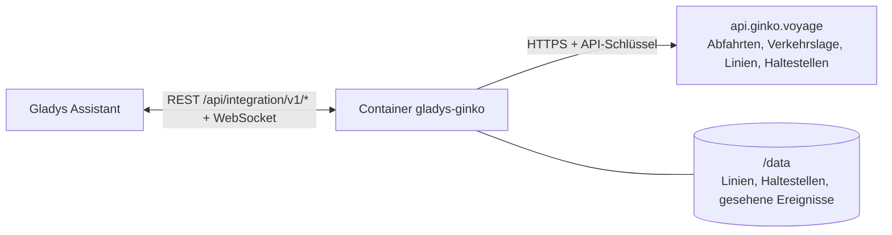
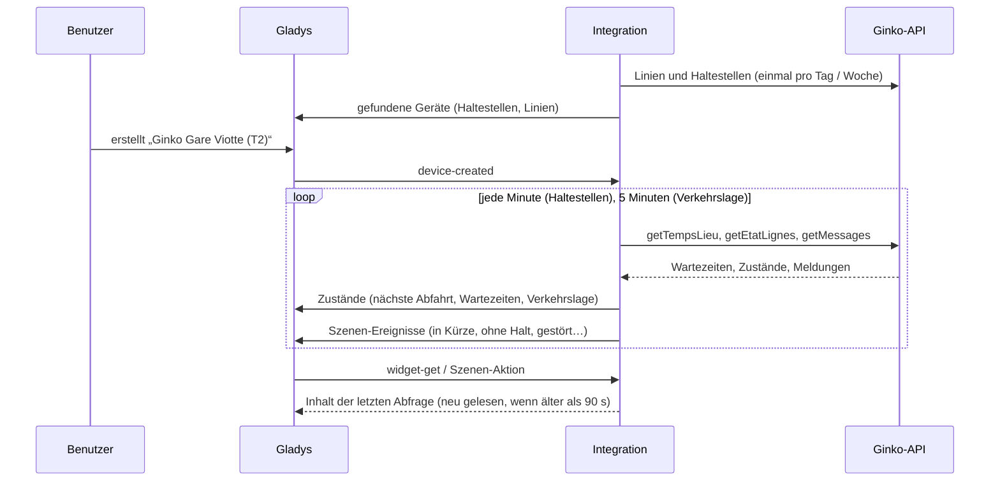
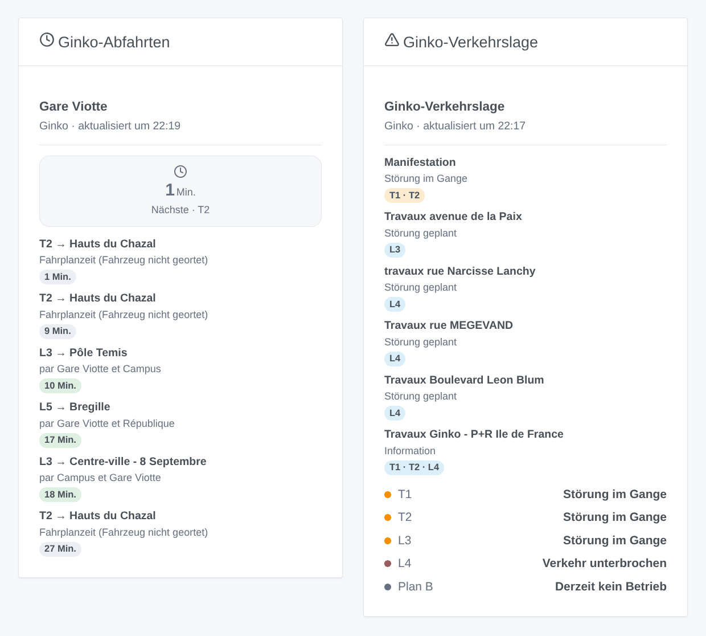

# Gladys Ginko

[English](README.md) · [Français](README.fr.md) · **Deutsch** · [Español](README.es.md)

[](LICENSE)
[](https://github.com/William-De71/gladys-ginko/releases)
[](https://github.com/William-De71/gladys-ginko/actions/workflows/release.yml)
[](https://gladysassistant.com)


Externe [Gladys Assistant](https://gladysassistant.com)-Integration für **Ginko**, das Bus- und Tramnetz von Besançon: die nächsten Abfahrten in Echtzeit an deinen Haltestellen, die Verkehrslage deiner Linien, Szenen und Dashboard-Widgets. Sie liest die Open-Data-API von Ginko mit einem kostenlosen Schlüssel.

Benutzerdokumentation: [English](docs/en.md) · [Français](docs/fr.md) · [Deutsch](docs/de.md) · [Español](docs/es.md).

> Community-Integration, weder mit Ginko, Keolis Besançon Mobilités noch Grand Besançon Métropole verbunden oder von ihnen unterstützt.

## Funktionen

- **Ein Gerät pro verfolgter Haltestelle** (bis zu drei), per Name — beide Straßenseiten — oder Kennung — eine Seite — eingegeben und nach **Linie** und **Richtung** gefiltert: nächste Abfahrt, Wartezeit der nächsten zwei Abfahrten, Fahrten ohne Halt.
- **Ein Gerät pro verfolgter Linie** (bis zu sechs): ihre Verkehrslage (normal, gestört, unterbrochen…) und die aktuellen Störungen.
- **5 Szenen-Auslöser**, **2 Szenen-Aktionen** und **2 Dashboard-Widgets** (siehe unten).
- Haltestellen standardmäßig jede Minute gelesen (30 s bis 5 min, nachts alle 10 min, wenn nichts angekündigt ist), Verkehrslage alle 5 Minuten; Linien und Haltestellen des Netzes in `/data` gespeichert.
- Konfigurationsschaltflächen: Verbindung testen, Haltestelle suchen (genaue Namen und Kennungen), Diagnose.
- Vier Sprachen überall: Englisch, Französisch, Deutsch, Spanisch.

## Funktionsweise




Beim Start liest die Integration die Linien des Tages (`DR/getLignes`) und die Haltestellen des Netzes (`DR/getArrets`) und löst deine Eingaben auf: „T1“ ist Linie 101, „Chamars“ beide Bahnsteige von Chamars, „t_cham1“ einer davon; einen Namen, den Ginko anders schreibt, fragt sie bei der unscharfen Suche der API ab („Pôle Temis“ → „Temis“). Dann liest sie in ihrem eigenen Takt die Abfahrten jeder Haltestelle (`TR/getTempsLieu`), behält die der gewählten Linie und Richtung, und die Verkehrslage der Linien (`TR/getEtatLignes` und `TR/getMessages`). Jede Abfrage wird mit der vorherigen verglichen, um die Szenen-Auslöser zu starten.



### Transport

Nur Cloud (`"transports": ["cloud"]`): Der Katalog zeigt das Cloud-Abzeichen. Die Integration kontaktiert `api.ginko.voyage` mit deinem Schlüssel; nur der Schlüssel und die Namen der verfolgten Haltestellen und Linien werden gesendet. Es gibt keinen lokalen Weg, daher keine Schaltfläche „Lokale Verbindung bevorzugen“.

## Geräte und Funktionen

| Gerät                 | Funktion                           | Kategorie / Typ              | Werte                             |
| --------------------- | ---------------------------------- | ---------------------------- | --------------------------------- |
| Ginko \<Haltestelle\> | Nächste Abfahrt                    | `text` / `text`              | „T2 → Hauts du Chazal · 3 Min.“   |
| Ginko \<Haltestelle\> | Wartezeit, Wartezeit der folgenden | `duration` / `integer`       | 0 … 180 Min.                      |
| Ginko \<Haltestelle\> | Fahrten ohne Halt                  | `counter-sensor` / `integer` | 0 … 20                            |
| Ginko Linie \<Linie\> | Verkehrslage                       | `text` / `text`              | „Störung im Gange: Manifestation“ |
| Ginko Linie \<Linie\> | Aktuelle Störungen                 | `counter-sensor` / `integer` | 0 … 20                            |

Ist das Fahrzeug nicht geortet, liefert Ginko die Fahrplanzeit: Die Texte sagen „Fahrplanzeit“ und das Widget zeigt sie grau. Nachts, ohne Abfahrt, behalten die Wartezeiten ihren letzten Wert (eine 0 würde einen Bus sofort ankündigen).

## Szenen-Auslöser, Aktionen und Widgets



**Szenen-Auslöser** (einmal pro Übergang; die erste Abfrage einer Haltestelle oder Linie dient als Referenz und löst nichts aus):

- **Bus oder Tram in Kürze**: Eine Fahrt, die an einer verfolgten Haltestelle hält, kommt in 2, 3, 5, 10, 15 oder 20 Minuten. Filter: Haltestelle, Minuten.
- **Haltestelle ohne Halt**: Die nächste Fahrt einer Linie hält nicht mehr an einer verfolgten Haltestelle („Non desservi“, „Déviation“). Filter: Haltestelle.
- **Linie gestört**: Eine verfolgte Linie wird gestört oder unterbrochen. Filter: Linie, Schwere.
- **Linie wieder normal**: Sie fährt wieder. Filter: Linie.
- **Neue Verkehrsmeldung**: Ginko veröffentlicht eine Meldung zu einer verfolgten Linie. Filter: Linie, Art (Information, geplant, im Gange, unterbrochen).

**Szenen-Aktionen**: **nächste Abfahrten** einer Haltestelle (Linie, Ziel, Wartezeit, Uhrzeit, die folgende, ein Satz) und **Verkehrslage einer Linie** (Zustand, Störungen, erste Meldung, ein Satz).

**Widgets**: **Ginko-Abfahrten** (eine verfolgte Haltestelle oder eine beliebige, in den Einstellungen eingegebene) und **Ginko-Verkehrslage** (die verfolgten Linien oder die eingegebenen).

Beispiele:

- Wenn **die T2 Richtung Hauts du Chazal in 5 Minuten an der Gare Viotte ankommt** → die Lampe im Flur grün einschalten.
- Wenn **die Linie L4 unterbrochen ist** → `{{triggerEvent.data.summary}}` und den Link aufs Handy senden.
- Jeden Werktag um 7:30 → **die nächsten Abfahrten** deiner Haltestelle lesen und die `summary` vom Küchenlautsprecher ansagen lassen.

## Voraussetzungen

- Gladys Assistant **5.1.1** oder neuer (Widgets und Szenen-Auslöser externer Integrationen). Ältere Instanzen können die Integration nicht installieren.
- Ein Ginko-API-Schlüssel, kostenlos, per E-Mail bei ginko.support-ssi@keolis.com angefordert (ein temporärer Schlüssel, 24 Stunden gültig, steht zum Ausprobieren auf [api.ginko.voyage](https://api.ginko.voyage/) bereit).

## Installation

- **Aus dem Store** von Gladys (Integrationen → Externe Integrationen), mit einem Klick, sobald indexiert.
- **Über die Repository-URL**: `https://github.com/William-De71/gladys-ginko`.
- **Entwicklermodus**: Baue das Image lokal (`docker build -t gladys-ginko .`) und installiere es aus Gladys.

## Konfiguration

| Feld                     | Beschreibung                                                                               |
| ------------------------ | ------------------------------------------------------------------------------------------ |
| API-Schlüssel            | Der Schlüssel der Open-Data-API von Ginko.                                                 |
| Haltestelle (1 bis 3)    | Ein Name („Chamars“) für beide Straßenseiten oder eine Kennung („t_cham1“) für eine Seite. |
| Linie                    | „T1“, „L3“, „3“, „Plan B“, „51“. Leer: alle Linien der Haltestelle.                        |
| Richtung                 | Wörter des Ziels: „Chalezeule“, „Temis \| Gare Viotte“. Leer: beide.                       |
| Verfolgte Linien         | Bis zu sechs, durch Kommas getrennt: „T1, L3, 7“.                                          |
| Abfrage der Haltestellen | 30 s, 1 min (Standard), 2 min oder 5 min.                                                  |
| Sprache der Texte        | Gerätenamen, Zusammenfassungen und Ausgaben der Szenen.                                    |

Schaltflächen: **Verbindung testen**, **Haltestelle suchen** (genaue Namen und Kennungen jeder Straßenseite) und **Diagnose** (schreibt Haltestellen, Linien, letzte Abfahrten und Fehler in den Tab Protokolle, nie den Schlüssel).

## Verwendung

1. Gib deinen API-Schlüssel, ein bis drei Haltestellen (mit Linie und Richtung, wenn du willst) und die zu verfolgenden Linien ein und speichere.
2. Erstelle im Tab **Entdecken** die Geräte „Ginko …“.
3. Füge die Widgets **Ginko-Abfahrten** und **Ginko-Verkehrslage** einem Dashboard hinzu und baue Szenen mit den Auslösern oben.

## Entwicklung

```bash
npm install
npm test                       # node --test, nie mit Netzwerkzugriff
npm run lint && npm run format:check
npx github:GladysAssistant/integration-store . --skip-image-check
scripts/build-cover.sh         # cover.jpg aus docs/assets/cover.svg
docs/illustrations/render.sh   # docs/assets/widgets.<lang>.png
node .github/scripts/release.mjs next
```

Lokal liest das SDK `GLADYS_HOST_API_URL`, `GLADYS_INTEGRATION_TOKEN` und `GLADYS_INTEGRATION_SELECTOR`; `GINKO_API_URL` lenkt die Integration auf eine andere API-Basis (ein Mock); `DEBUG=gladys-integration-sdk` zeigt die SDK-Protokolle und prüft jeden Widget-Inhalt. Die Tests nutzen echte, gekürzte Antworten der Ginko-API (`test/fixtures/`, ODbL). Die Regeln des Projekts stehen in [CLAUDE.md](CLAUDE.md).

## Release-Prozess


Jeder Merge auf `main` startet die CI und berechnet dann die Version aus den [Conventional Commits](https://www.conventionalcommits.org/) seit dem letzten Tag: `feat` → Minor, `fix` / `perf` → Patch, `!` oder `BREAKING CHANGE` → Major (ein Minor vor 1.0.0); `docs`, `chore`, `ci`, `test`, `style`, `refactor`, `build` allein veröffentlichen nichts. Der Changelog-Abschnitt wird erzeugt, der Tag gepusht, das Multi-Architektur-Image gebaut, dann erhält `main` den Release-Commit, das GitHub Release wird erstellt und ein letzter Job prüft das öffentliche Image, den Store-Validator und das Topic.

- Der Titel des Pull Requests wird zum Squash-Commit und dann zur Changelog-Zeile: Schreibe ihn auf Englisch, für den Benutzer (`pr-title.yml` prüft ihn). Bearbeite `CHANGELOG.md` nie von Hand.
- 1.0.0 ist eine Entscheidung: Actions → Release → Run workflow mit `release-as: 1.0.0`. `dry-run` zeigt Version und Notizen, ohne zu veröffentlichen.
- **Geschützter Branch**: Das Release pusht seinen Commit mit `GITHUB_TOKEN` auf `main`. Mit einem Ruleset auf `main` füge GitHub Actions seiner Bypass-Liste hinzu (oder pushe über eine GitHub App), sonst schlägt der Veröffentlichungsjob mit Anweisungen fehl.
- Mache nach dem ersten Release das Paket `ghcr.io` öffentlich (Package settings → Change visibility), sonst kann Gladys es nicht laden.

## Fehlerbehebung

Siehe [docs/de.md](docs/de.md#fehlerbehebung). Melde Probleme mit den Versionen von Gladys und der Integration, der betroffenen Haltestelle oder Linie und den Zeilen der Schaltfläche **Diagnose**.

## Mitwirken

Issues und Pull Requests sind willkommen. Führe `npm run format:check && npm run lint && npm test` aus, bevor du einen Pull Request öffnest, und lass alle externen Kennungen und gespeicherten Schlüssel unverändert (siehe [CLAUDE.md](CLAUDE.md)).

## Sicherheit

Siehe [SECURITY.md](SECURITY.md): Melde Schwachstellen vertraulich. Der API-Schlüssel ist ein `secret`-Feld von Gladys, wird nur an `api.ginko.voyage` gesendet und nie in die Protokolle geschrieben; die Integration läuft schreibgeschützt, ohne Root-Rechte, in ihrem Container.

## Kommende Screenshots

Die Bilder oben sind Illustrationen, keine Screenshots. Echte Screenshots kommen nach `docs/assets/screenshots/` (PNG, 1280 × 800): `configuration.png`, `discovery.png`, `device.png`, `scene.png`.

## Lizenz

[Apache License 2.0](LICENSE) — siehe auch [NOTICE](NOTICE). Abfahrten, Linien, Haltestellen und Verkehrsmeldungen sind offene Daten von Ginko (Keolis Besançon Mobilités, Grand Besançon Métropole) unter der [ODbL](https://opendatacommons.org/licenses/odbl/1-0/): Die Widgets zeigen die Quelle und die Uhrzeit jeder Abfrage. Danke an die Dokumentation und das SDK von Gladys und an das Ginko-Team für die Öffnung seiner Echtzeitdaten.
