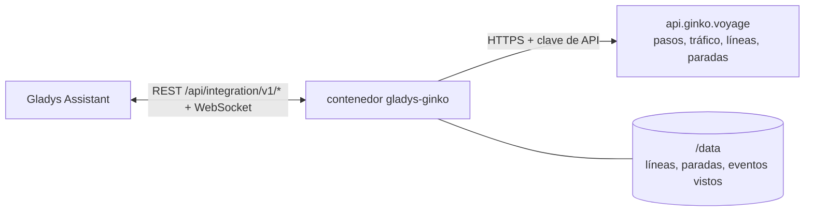
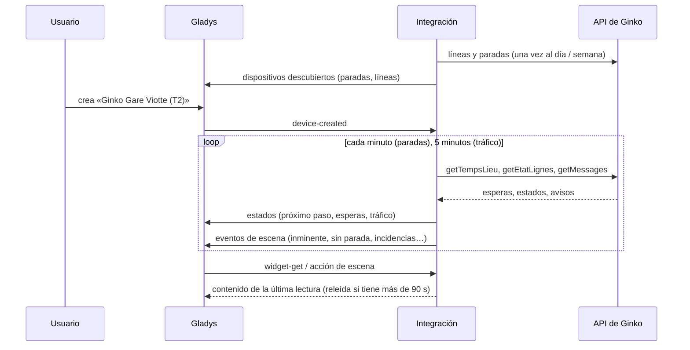
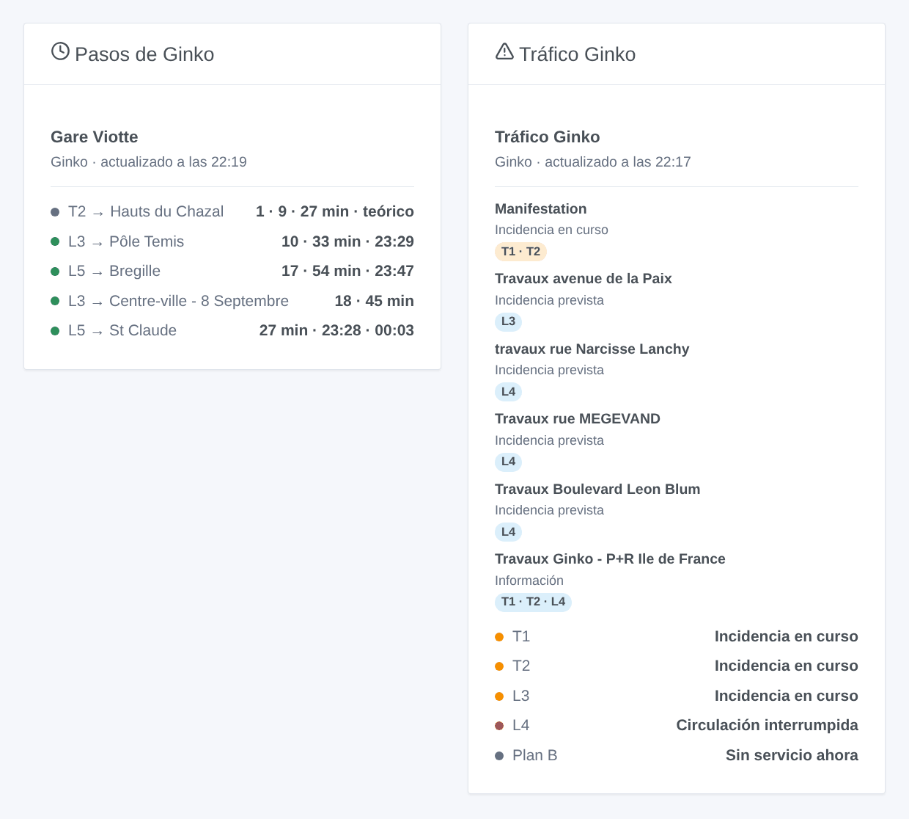

# Gladys Ginko

[English](README.md) · [Français](README.fr.md) · [Deutsch](README.de.md) · **Español**

[](LICENSE)
[](https://github.com/William-De71/gladys-ginko/releases)
[](https://github.com/William-De71/gladys-ginko/actions/workflows/release.yml)
[](https://gladysassistant.com)


Integración externa de [Gladys Assistant](https://gladysassistant.com) para **Ginko**, la red de autobuses y tranvía de Besanzón: los próximos pasos en tiempo real en tus paradas, el tráfico de tus líneas, escenas y widgets del panel. Lee la API de datos abiertos de Ginko con una clave gratuita.

Documentación de usuario: [English](docs/en.md) · [Français](docs/fr.md) · [Deutsch](docs/de.md) · [Español](docs/es.md).

> Integración comunitaria, sin afiliación ni respaldo de Ginko, Keolis Besançon Mobilités o Grand Besançon Métropole.

## Funciones

- **Un dispositivo por parada seguida** (tres en el formulario, hasta 20 más con el botón **Añadir una parada**), escrita por su nombre — ambos lados de la calle — o por su identificador — un solo lado — y filtrada por **línea** y **dirección**: próximo paso, espera de los dos próximos pasos, pasos sin parada.
- **Un dispositivo por línea seguida** (hasta seis): su tráfico (normal, con incidencias, interrumpida…) y las incidencias en curso.
- **5 disparadores de escena**, **2 acciones de escena** y **2 widgets del panel** (abajo).
- Paradas leídas cada minuto por defecto (de 30 s a 5 min, cada 10 min de noche cuando no se anuncia nada), tráfico cada 5 minutos; líneas y paradas de la red guardadas en `/data`.
- Botones de configuración: probar la conexión, buscar una parada (nombres exactos, identificadores y direcciones de cada lado de la calle), añadir / quitar / listar paradas, diagnóstico.
- Cuatro idiomas en todas partes: inglés, francés, alemán, español.

## Funcionamiento




Al arrancar, la integración lee las líneas del día (`DR/getLignes`) y las paradas de la red (`DR/getArrets`), y resuelve lo que escribiste: «T1» es la línea 101, «Chamars» los dos andenes de Chamars, «t_cham1» uno de ellos; un nombre que Ginko escribe de otra forma se pregunta a la búsqueda aproximada de la API («Pôle Temis» → «Temis»). Después lee a su propio ritmo los pasos de cada parada (`TR/getTempsLieu`), conserva los de la línea y dirección elegidas, y el tráfico de las líneas (`TR/getEtatLignes` y `TR/getMessages`). Cada lectura se compara con la anterior para lanzar los disparadores de escena.



### Transporte

Solo cloud (`"transports": ["cloud"]`): el catálogo muestra la insignia cloud. La integración contacta con `api.ginko.voyage` con tu clave; solo se envían la clave y los nombres de las paradas y líneas seguidas. No hay vía local, así que no hay botón «Preferir la conexión local».

## Dispositivos y funciones

| Dispositivo           | Función                      | Categoría / tipo             | Valores                              |
| --------------------- | ---------------------------- | ---------------------------- | ------------------------------------ |
| Ginko \<parada\>      | Próximo paso                 | `text` / `text`              | «T2 → Hauts du Chazal · 3 min»       |
| Ginko \<parada\>      | Espera, espera del siguiente | `duration` / `integer`       | 0 … 180 min                          |
| Ginko \<parada\>      | Pasos sin parada             | `counter-sensor` / `integer` | 0 … 20                               |
| Ginko línea \<línea\> | Tráfico                      | `text` / `text`              | «Incidencia en curso: Manifestation» |
| Ginko línea \<línea\> | Incidencias en curso         | `counter-sensor` / `integer` | 0 … 20                               |

Cuando el vehículo no está localizado, Ginko da el horario teórico: los textos dicen «horario teórico» y el widget lo muestra en gris. De noche, sin ningún paso, las esperas conservan su último valor (un 0 anunciaría un autobús ya).

## Disparadores, acciones de escena y widgets



**Disparadores de escena** (una vez por transición; la primera lectura de una parada o línea sirve de referencia y no dispara nada):

- **Autobús o tranvía inminente**: un paso que para en una parada seguida llega dentro de 2, 3, 5, 10, 15 o 20 minutos. Filtros: parada, minutos.
- **Parada sin servicio**: el próximo paso de una línea ya no para en una parada seguida («Non desservi», «Déviation»). Filtro: parada.
- **Línea con incidencias**: una línea seguida pasa a tener incidencias o queda interrumpida. Filtros: línea, gravedad.
- **Línea vuelve a la normalidad**: vuelve a circular. Filtro: línea.
- **Nuevo aviso de tráfico**: Ginko publica un aviso sobre una línea seguida. Filtros: línea, tipo (información, prevista, en curso, interrumpida).

**Acciones de escena**: **próximos pasos** de una parada (línea, destino, espera, hora, el siguiente, una frase) y **tráfico de una línea** (estado, incidencias, primer aviso, una frase).

**Widgets**: **Pasos de Ginko** (una parada seguida, o cualquier parada escrita en los ajustes) y **Tráfico Ginko** (las líneas seguidas, o las escritas).

Ejemplos:

- Cuando **el T2 hacia Hauts du Chazal llegue a Gare Viotte dentro de 5 minutos** → encender en verde la lámpara de la entrada.
- Cuando **la línea L4 esté interrumpida** → enviar `{{triggerEvent.data.summary}}` y el enlace a tu teléfono.
- Cada día laborable a las 7:30 → **leer los próximos pasos** de tu parada y que el altavoz de la cocina anuncie el `summary`.

## Requisitos

- Gladys Assistant **5.1.1** o posterior (widgets y disparadores de escena de las integraciones externas). Las instancias anteriores no pueden instalar la integración.
- Una clave de API de Ginko, gratuita, pedida por correo a ginko.support-ssi@keolis.com (hay una clave temporal válida 24 horas en [api.ginko.voyage](https://api.ginko.voyage/) para probar).

## Instalación

- **Desde la tienda** de Gladys (Integraciones → Integraciones externas), con un clic, una vez indexada.
- **Desde la URL del repositorio**: `https://github.com/William-De71/gladys-ginko`.
- **Modo desarrollador**: construye la imagen en local (`docker build -t gladys-ginko .`) e instálala desde Gladys.

## Configuración

| Campo                  | Descripción                                                                                  |
| ---------------------- | -------------------------------------------------------------------------------------------- |
| Clave de API           | La clave de la API de datos abiertos de Ginko.                                               |
| Parada (1 a 3)         | Un nombre («Chamars») para ambos lados de la calle, o un identificador («t_cham1») para uno. |
| Línea                  | «T1», «L3», «3», «Plan B», «51». Vacío: todas las líneas de la parada.                       |
| Dirección              | Palabras del destino: «Chalezeule», «Temis \| Gare Viotte». Vacío: ambos sentidos.           |
| Líneas seguidas        | Hasta seis, separadas por comas: «T1, L3, 7».                                                |
| Lectura de las paradas | 30 s, 1 min (por defecto), 2 min o 5 min.                                                    |
| Idioma de los textos   | Nombres de los dispositivos, resúmenes y salidas de las escenas.                             |

Botones: **Probar la conexión**, **Buscar una parada** (nombres exactos, identificadores y direcciones de cada lado de la calle), **Añadir una parada**, **Quitar una parada**, **Listar las paradas** (las paradas más allá de las tres del formulario, guardadas en la configuración de Gladys) y **Diagnóstico** (escribe las paradas, líneas, últimos pasos y errores en la pestaña Registros, nunca la clave).

## Uso

1. Escribe tu clave de API, de una a tres paradas — más con **Añadir una parada** — (con su línea y dirección si quieres) y las líneas que seguir, y guarda.
2. En la pestaña **Descubrir**, crea los dispositivos «Ginko …».
3. Añade los widgets **Pasos de Ginko** y **Tráfico Ginko** a un panel, y crea escenas con los disparadores de arriba.

## Desarrollo

```bash
npm install
npm test                       # node --test, nunca toca la red
npm run lint && npm run format:check
npx github:GladysAssistant/integration-store . --skip-image-check
scripts/build-cover.sh         # cover.jpg desde docs/assets/cover.svg
docs/illustrations/render.sh   # docs/assets/widgets.<lang>.png
node .github/scripts/release.mjs next
```

En local, el SDK lee `GLADYS_HOST_API_URL`, `GLADYS_INTEGRATION_TOKEN` y `GLADYS_INTEGRATION_SELECTOR`; `GINKO_API_URL` dirige la integración a otra raíz de API (un simulador); `DEBUG=gladys-integration-sdk` muestra los registros del SDK y comprueba cada contenido de widget. Las pruebas usan respuestas reales de la API de Ginko, reducidas (`test/fixtures/`, ODbL). Las reglas del proyecto están en [CLAUDE.md](CLAUDE.md).

## Proceso de publicación


Cada fusión en `main` lanza la CI y luego calcula la versión a partir de los [Conventional Commits](https://www.conventionalcommits.org/) desde la última etiqueta: `feat` → menor, `fix` / `perf` → parche, `!` o `BREAKING CHANGE` → mayor (una menor antes de 1.0.0); `docs`, `chore`, `ci`, `test`, `style`, `refactor`, `build` solos no publican nada. Se genera la sección del changelog, se sube la etiqueta, se construye la imagen multiarquitectura, después `main` recibe el commit de publicación, se crea la GitHub Release y un último job comprueba la imagen pública, el validador de la tienda y el topic.

- El título de la pull request se convierte en el commit squash y luego en la línea del changelog: escríbelo en inglés, para el usuario (`pr-title.yml` lo comprueba). Nunca edites `CHANGELOG.md` a mano.
- La 1.0.0 es una decisión: Actions → Release → Run workflow con `release-as: 1.0.0`. `dry-run` muestra la versión y las notas sin publicar nada.
- **Rama protegida**: la publicación sube su commit a `main` con `GITHUB_TOKEN`. Con un ruleset en `main`, añade GitHub Actions a su lista de excepciones (o sube mediante una GitHub App); si no, el job de publicación falla con instrucciones.
- Tras la primera publicación, haz público el paquete `ghcr.io` (Package settings → Change visibility); si no, Gladys no puede descargarlo.

## Solución de problemas

Consulta [docs/es.md](docs/es.md#solución-de-problemas). Informa de los problemas con las versiones de Gladys y de la integración, la parada o línea afectada, y las líneas del botón **Diagnóstico**.

## Contribuir

Issues y pull requests son bienvenidas. Ejecuta `npm run format:check && npm run lint && npm test` antes de abrir una pull request, y no cambies ningún identificador externo ni clave guardada (consulta [CLAUDE.md](CLAUDE.md)).

## Seguridad

Consulta [SECURITY.md](SECURITY.md): informa de las vulnerabilidades en privado. La clave de API es un campo `secret` de Gladys, enviado solo a `api.ginko.voyage` y nunca escrito en los registros; la integración se ejecuta en solo lectura, sin privilegios root, en su contenedor.

## Capturas pendientes

Las imágenes de arriba son ilustraciones, no capturas de pantalla. Las capturas reales irán en `docs/assets/screenshots/` (PNG, 1280 × 800): `configuration.png`, `discovery.png`, `device.png`, `scene.png`.

## Licencia

[Licencia Apache 2.0](LICENSE) — consulta también [NOTICE](NOTICE). Los pasos, líneas, paradas y avisos de tráfico son datos abiertos de Ginko (Keolis Besançon Mobilités, Grand Besançon Métropole) bajo la [ODbL](https://opendatacommons.org/licenses/odbl/1-0/): los widgets muestran la fuente y la hora de cada lectura. Gracias a la documentación y al SDK de Gladys, y al equipo de Ginko por abrir sus datos en tiempo real.
