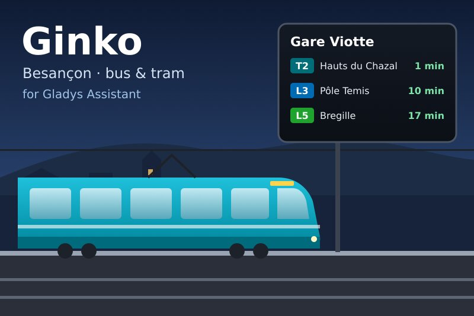
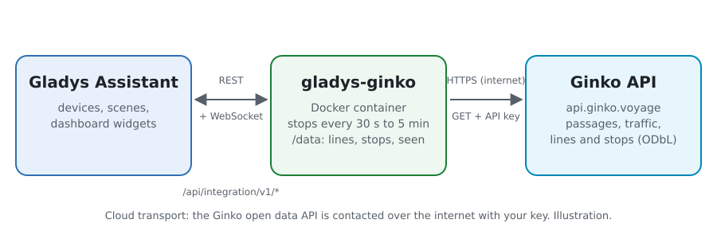
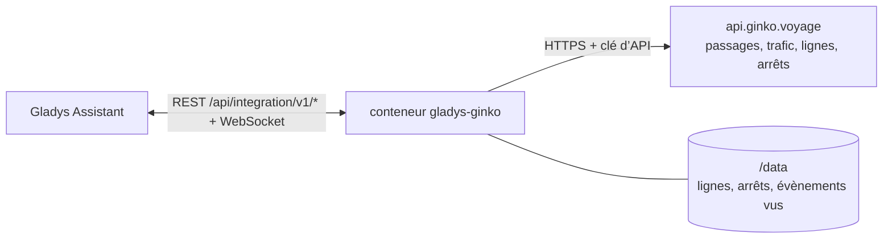
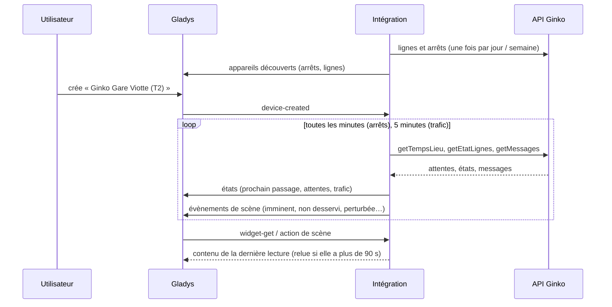
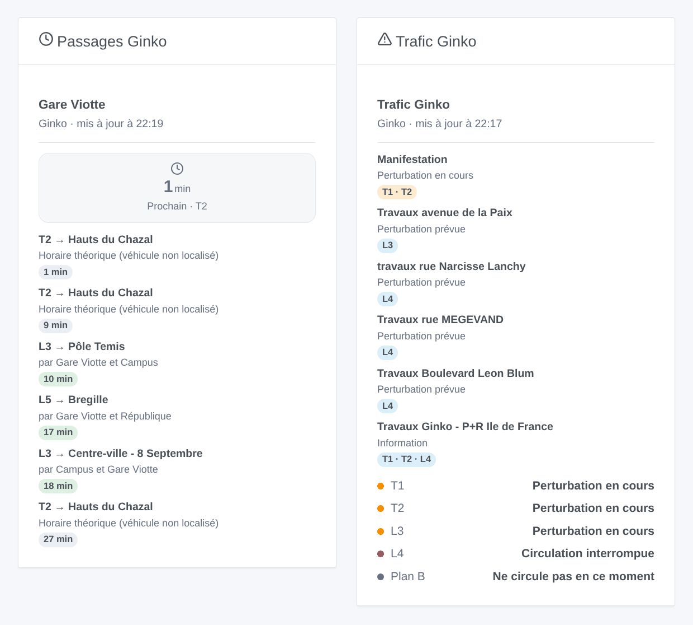

# Gladys Ginko

[English](README.md) · **Français** · [Deutsch](README.de.md) · [Español](README.es.md)

[](LICENSE)
[](https://github.com/William-De71/gladys-ginko/releases)
[](https://github.com/William-De71/gladys-ginko/actions/workflows/release.yml)
[](https://gladysassistant.com)



Intégration externe [Gladys Assistant](https://gladysassistant.com) pour **Ginko**, le réseau de bus et de tram de Besançon : les prochains passages en temps réel à vos arrêts, le trafic de vos lignes, des scènes et des widgets de tableau de bord. Elle lit l’API open data de Ginko avec une clé gratuite.

Documentation utilisateur : [English](docs/en.md) · [Français](docs/fr.md) · [Deutsch](docs/de.md) · [Español](docs/es.md).

> Intégration communautaire, ni affiliée ni soutenue par Ginko, Keolis Besançon Mobilités ou Grand Besançon Métropole.

## Fonctionnalités

- **Un appareil par arrêt suivi** (trois dans le formulaire, jusqu’à 20 de plus avec le bouton **Ajouter un arrêt**), saisi par son nom — les deux côtés de la rue — ou par son identifiant — un seul côté — et filtré par **ligne** et **direction** : prochain passage, attente des deux prochains passages, passages sans desserte.
- **Un appareil par ligne suivie** (six au plus) : son trafic (normal, perturbé, interrompu…) et les perturbations en cours.
- **5 déclencheurs de scène**, **2 actions de scène** et **2 widgets de tableau de bord** (ci-dessous).
- Arrêts lus toutes les minutes par défaut (30 s à 5 min, toutes les 10 min la nuit quand rien n’est annoncé), trafic toutes les 5 minutes ; lignes et arrêts du réseau gardés dans `/data`.
- Boutons de configuration : tester la connexion, chercher un arrêt (noms exacts, identifiants et directions de chaque côté de la rue), ajouter / retirer / lister les arrêts, diagnostic.
- Quatre langues partout : anglais, français, allemand, espagnol.

## Fonctionnement





Au démarrage, l’intégration lit les lignes du jour (`DR/getLignes`) et les arrêts du réseau (`DR/getArrets`), et résout ce que vous avez saisi : « T1 » est la ligne 101, « Chamars » les deux quais de Chamars, « t_cham1 » l’un d’eux ; un nom que Ginko écrit autrement est demandé à la recherche approchée de l’API (« Pôle Temis » → « Temis »). Elle lit ensuite les passages de chaque arrêt (`TR/getTempsLieu`) à son propre rythme, garde ceux de la ligne et de la direction choisies, et le trafic des lignes (`TR/getEtatLignes` et `TR/getMessages`). Chaque lecture est comparée à la précédente pour lancer les déclencheurs de scène.



### Transport

Cloud uniquement (`"transports": ["cloud"]`) : le catalogue affiche le badge cloud. L’intégration contacte `api.ginko.voyage` avec votre clé ; seuls la clé et les noms des arrêts et lignes suivis sont envoyés. Il n’y a pas de voie locale, donc pas de bouton « Préférer la connexion locale ».

## Appareils et fonctionnalités

| Appareil              | Fonctionnalité              | Catégorie / type             | Valeurs                                   |
| --------------------- | --------------------------- | ---------------------------- | ----------------------------------------- |
| Ginko \<arrêt\>       | Prochain passage            | `text` / `text`              | « T2 → Hauts du Chazal · 3 min »          |
| Ginko \<arrêt\>       | Attente, attente du suivant | `duration` / `integer`       | 0 … 180 min                               |
| Ginko \<arrêt\>       | Passages sans desserte      | `counter-sensor` / `integer` | 0 … 20                                    |
| Ginko ligne \<ligne\> | Trafic                      | `text` / `text`              | « Perturbation en cours : Manifestation » |
| Ginko ligne \<ligne\> | Perturbations en cours      | `counter-sensor` / `integer` | 0 … 20                                    |

Quand le véhicule n’est pas localisé, Ginko donne l’horaire théorique : les textes indiquent « horaire théorique » et le widget l’affiche en gris. La nuit, sans aucun passage, les attentes gardent leur dernière valeur (un 0 annoncerait un bus tout de suite).

## Déclencheurs, actions de scène et widgets



**Déclencheurs de scène** (une fois par transition ; la première lecture d’un arrêt ou d’une ligne sert de référence et ne déclenche rien) :

- **Bus ou tram imminent** : un passage desservant un arrêt suivi arrive dans 2, 3, 5, 10, 15 ou 20 minutes. Filtres : arrêt, minutes.
- **Arrêt non desservi** : le prochain passage d’une ligne ne dessert plus un arrêt suivi (« Non desservi », « Déviation »). Filtre : arrêt.
- **Ligne perturbée** : une ligne suivie devient perturbée ou interrompue. Filtres : ligne, gravité.
- **Retour à la normale** : elle circule de nouveau. Filtre : ligne.
- **Nouvelle info trafic** : Ginko publie un message sur une ligne suivie. Filtres : ligne, type (information, prévue, en cours, interrompue).

**Actions de scène** : **prochains passages** d’un arrêt (ligne, destination, attente, heure, le suivant, une phrase) et **trafic d’une ligne** (état, perturbations, premier message, une phrase).

**Widgets** : **Passages Ginko** (un arrêt suivi, plusieurs dans une même liste, ou n’importe quel arrêt saisi dans les réglages) et **Trafic Ginko** (les lignes suivies, ou celles saisies).

Exemples :

- Quand **le T2 vers Hauts du Chazal arrive à Gare Viotte dans 5 minutes** → allumer la lampe de l’entrée en vert.
- Quand **la ligne L4 est interrompue** → envoyer `{{triggerEvent.data.summary}}` et le lien sur votre téléphone.
- Chaque jour de semaine à 7 h 30 → **lire les prochains passages** de votre arrêt et faire annoncer le `summary` par l’enceinte de la cuisine.

## Prérequis

- Gladys Assistant **5.3.0** ou plus récent (widgets et déclencheurs de scène des intégrations externes, mots-clés et pays du catalogue de Gladys 5.3). Les instances plus anciennes ne peuvent pas installer l’intégration.
- Une clé d’API Ginko, gratuite, demandée par e-mail à ginko.support-ssi@keolis.com (une clé temporaire valable 24 heures est disponible sur [api.ginko.voyage](https://api.ginko.voyage/) pour essayer).

## Installation

- **Depuis le store** de Gladys (Intégrations → Intégrations externes), en un clic, une fois indexée.
- **Depuis l’URL du dépôt** : `https://github.com/William-De71/gladys-ginko`.
- **Mode développeur** : construisez l’image en local (`docker build -t gladys-ginko .`) et installez-la depuis Gladys.

## Configuration

| Champ              | Description                                                                                       |
| ------------------ | ------------------------------------------------------------------------------------------------- |
| Clé d’API          | La clé de l’API open data de Ginko.                                                               |
| Arrêt (1 à 3)      | Un nom (« Chamars ») pour les deux côtés de la rue, ou un identifiant (« t_cham1 ») pour un seul. |
| Ligne              | « T1 », « L3 », « 3 », « Plan B », « 51 ». Vide : toutes les lignes de l’arrêt.                   |
| Direction          | Mots de la destination : « Chalezeule », « Temis \| Gare Viotte ». Vide : les deux sens.          |
| Lignes suivies     | Six au plus, séparées par des virgules : « T1, L3, 7 ».                                           |
| Lecture des arrêts | 30 s, 1 min (par défaut), 2 min ou 5 min.                                                         |
| Langue des textes  | Noms des appareils, résumés et sorties des scènes.                                                |

Boutons : **Tester la connexion**, **Chercher un arrêt** (noms exacts, identifiants et directions de chaque côté de la rue), **Ajouter un arrêt**, **Retirer un arrêt**, **Lister les arrêts** (les arrêts au-delà des trois du formulaire, gardés dans la configuration de Gladys) et **Diagnostic** (écrit les arrêts, lignes, derniers passages et erreurs dans l’onglet Journaux, jamais la clé).

## Utilisation

1. Saisissez votre clé d’API, un à trois arrêts — plus avec **Ajouter un arrêt** — (avec leur ligne et leur direction si vous voulez) et les lignes à suivre, puis enregistrez.
2. Dans l’onglet **Découvrir**, créez les appareils « Ginko … ».
3. Ajoutez les widgets **Passages Ginko** et **Trafic Ginko** à un tableau de bord, et créez des scènes avec les déclencheurs ci-dessus.

## Développement

```bash
npm install
npm test                       # node --test, ne touche jamais le réseau
npm run lint && npm run format:check
npx github:GladysAssistant/integration-store . --skip-image-check
scripts/build-cover.sh         # cover.jpg depuis docs/assets/cover.svg
docs/illustrations/render.sh   # docs/assets/widgets.<lang>.png
node .github/scripts/release.mjs next
```

En local, le SDK lit `GLADYS_HOST_API_URL`, `GLADYS_INTEGRATION_TOKEN` et `GLADYS_INTEGRATION_SELECTOR` ; `GINKO_API_URL` dirige l’intégration vers une autre racine d’API (un bouchon) ; `DEBUG=gladys-integration-sdk` affiche les journaux du SDK et vérifie chaque contenu de widget. Les tests utilisent de vraies réponses de l’API Ginko, réduites (`test/fixtures/`, ODbL). Les règles du projet sont dans [CLAUDE.md](CLAUDE.md).

## Processus de release


Chaque fusion sur `main` lance la CI, puis calcule la version depuis les [Conventional Commits](https://www.conventionalcommits.org/) depuis le dernier tag : `feat` → mineure, `fix` / `perf` → correctif, `!` ou `BREAKING CHANGE` → majeure (une mineure avant 1.0.0) ; `docs`, `chore`, `ci`, `test`, `style`, `refactor`, `build` seuls ne publient rien. La section du changelog est générée, le tag poussé, l’image multi-architecture construite, puis `main` reçoit le commit de release, la GitHub Release est créée et un dernier job vérifie l’image publique, le validateur du store et le topic.

- Le titre de la pull request devient le commit squash, puis la ligne du changelog : écrivez-le en anglais, pour l’utilisateur (`pr-title.yml` le vérifie). Ne modifiez jamais `CHANGELOG.md` à la main.
- La 1.0.0 est une décision : Actions → Release → Run workflow avec `release-as: 1.0.0`. `dry-run` affiche la version et les notes sans rien publier.
- **Branche protégée** : la release pousse son commit sur `main` avec `GITHUB_TOKEN`. Avec un ruleset sur `main`, ajoutez GitHub Actions à sa liste de contournement (ou poussez via une GitHub App), sinon le job de publication échoue avec des instructions.
- Après la première release, rendez public le package `ghcr.io` (Package settings → Change visibility), sinon Gladys ne peut pas le télécharger.

## Dépannage

Voir [docs/fr.md](docs/fr.md#dépannage). Signalez les problèmes avec les versions de Gladys et de l’intégration, l’arrêt ou la ligne concerné, et les lignes du bouton **Diagnostic**.

## Contribuer

Issues et pull requests bienvenues. Lancez `npm run format:check && npm run lint && npm test` avant d’ouvrir une pull request, et gardez inchangés tous les identifiants externes et clés stockées (voir [CLAUDE.md](CLAUDE.md)).

## Sécurité

Voir [SECURITY.md](SECURITY.md) : signalez les vulnérabilités en privé. La clé d’API est un champ `secret` de Gladys, envoyé seulement à `api.ginko.voyage` et jamais écrit dans les journaux ; l’intégration tourne en lecture seule, sans droits root, dans son conteneur.

## Captures à venir

Les images ci-dessus sont des illustrations, pas des captures d’écran. Les vraies captures iront dans `docs/assets/screenshots/` (PNG, 1280 × 800) : `configuration.png`, `discovery.png`, `device.png`, `scene.png`.

## Licence

[Licence Apache 2.0](LICENSE) — voir aussi [NOTICE](NOTICE). Les passages, lignes, arrêts et messages de trafic sont des données ouvertes de Ginko (Keolis Besançon Mobilités, Grand Besançon Métropole) sous licence [ODbL](https://opendatacommons.org/licenses/odbl/1-0/) : les widgets affichent la source et l’heure de chaque lecture. Merci à la documentation et au SDK de Gladys, et à l’équipe Ginko d’ouvrir ses données temps réel.
