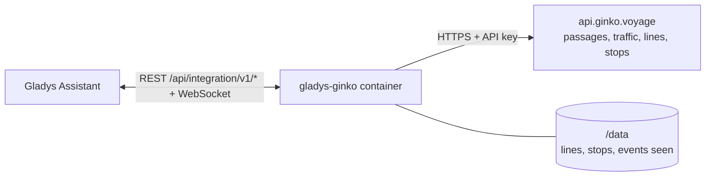
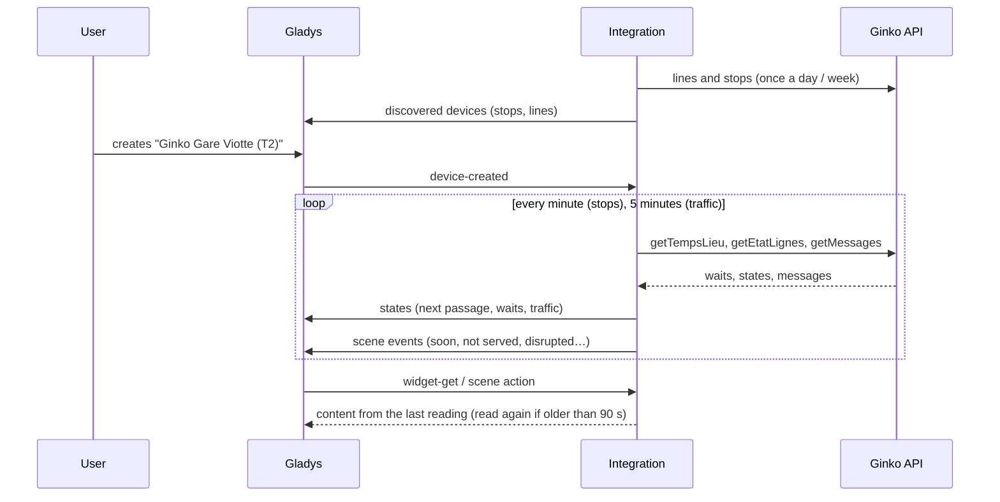
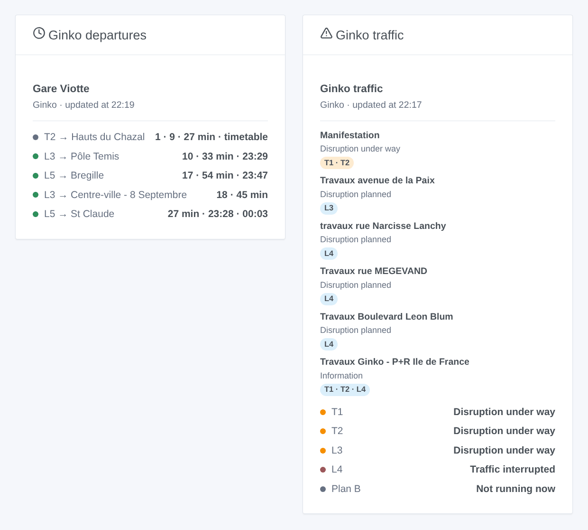

# Gladys Ginko

**English** · [Français](README.fr.md) · [Deutsch](README.de.md) · [Español](README.es.md)

[](LICENSE)
[](https://github.com/William-De71/gladys-ginko/releases)
[](https://github.com/William-De71/gladys-ginko/actions/workflows/release.yml)
[](https://gladysassistant.com)


[Gladys Assistant](https://gladysassistant.com) external integration for **Ginko**, the bus and tram network of Besançon: the next passages in real time at your stops, the traffic of your lines, scenes and dashboard widgets. It reads the open data API of Ginko with a free key.

User documentation: [English](docs/en.md) · [Français](docs/fr.md) · [Deutsch](docs/de.md) · [Español](docs/es.md).

> Community integration, not affiliated with nor endorsed by Ginko, Keolis Besançon Mobilités or Grand Besançon Métropole.

## Features

- **One device per followed stop** (three in the form, up to 20 more with the **Add a stop** button), typed by name — both sides of the street — or by id — one side — and filtered by **line** and **direction**: next passage, wait of the next two passages, passages not serving the stop.
- **One device per followed line** (up to six): its traffic (normal, disrupted, interrupted…) and the disruptions under way.
- **5 scene triggers**, **2 scene actions** and **2 dashboard widgets** (below).
- Stops read every minute by default (30 s to 5 min, every 10 min at night when nothing is announced), traffic every 5 minutes; lines and stops of the network kept in `/data`.
- Configuration buttons: test the connection, find a stop (exact names, ids and directions of each side of the street), add / remove / list stops, diagnostic.
- Four languages everywhere: English, French, German, Spanish.

## How it works




At start, the integration reads the lines of the day (`DR/getLignes`) and the stops of the network (`DR/getArrets`), and resolves what you typed: "T1" is line 101, "Chamars" both platforms of Chamars, "t_cham1" one of them; a name Ginko spells differently is asked to the fuzzy search of the API ("Pôle Temis" → "Temis"). Then it reads the passages of each stop (`TR/getTempsLieu`) on its own timer, keeps the ones of the chosen line and direction, and the traffic of the lines (`TR/getEtatLignes` and `TR/getMessages`). Each reading is compared with the previous one to fire the scene triggers.



### Transport

Cloud only (`"transports": ["cloud"]`): the catalog shows the cloud badge. The integration contacts `api.ginko.voyage` with your key; only the key and the names of the followed stops and lines are sent. There is no local alternative, so there is no "prefer the local connection" button.

## Devices and features

| Device              | Feature                       | Category / type              | Values                                |
| ------------------- | ----------------------------- | ---------------------------- | ------------------------------------- |
| Ginko \<stop\>      | Next passage                  | `text` / `text`              | "T2 → Hauts du Chazal · 3 min"        |
| Ginko \<stop\>      | Wait, wait for the following  | `duration` / `integer`       | 0 … 180 min                           |
| Ginko \<stop\>      | Passages not serving the stop | `counter-sensor` / `integer` | 0 … 20                                |
| Ginko line \<line\> | Traffic                       | `text` / `text`              | "Disruption under way: Manifestation" |
| Ginko line \<line\> | Disruptions under way         | `counter-sensor` / `integer` | 0 … 20                                |

When the vehicle is not located, Ginko gives the timetable time: the texts say "timetable" and the widget shows it in grey. At night, without any passage, the waits keep their last value (a 0 would announce a bus now).

## Scene triggers, actions and widgets



**Scene triggers** (once per transition; the first reading of a stop or a line is a reference and fires nothing):

- **Bus or tram soon**: a passage serving a followed stop arrives in 2, 3, 5, 10, 15 or 20 minutes. Filters: stop, minutes.
- **Stop not served**: the next passage of a line no longer serves a followed stop ("Non desservi", "Déviation"). Filter: stop.
- **Line disrupted**: a followed line becomes disrupted or interrupted. Filters: line, severity.
- **Line back to normal**: it runs again. Filter: line.
- **New traffic message**: Ginko publishes a message about a followed line. Filters: line, kind (information, planned, under way, interrupted).

**Scene actions**: **next passages** of a stop (line, destination, wait, time, the following one, a sentence) and **traffic of a line** (state, disruptions, first message, a sentence).

**Widgets**: **Ginko departures** (a followed stop, several in one list, or any stop typed in the settings) and **Ginko traffic** (the followed lines, or the ones typed).

Examples:

- When **the T2 towards Hauts du Chazal arrives at Gare Viotte in 5 minutes** → light the hall lamp in green.
- When **line L4 is interrupted** → send `{{triggerEvent.data.summary}}` and the link to your phone.
- Every weekday at 7:30 → **read the next passages** of your stop and have the `summary` spoken by the kitchen speaker.

## Requirements

- Gladys Assistant **5.1.1** or later (widgets and scene triggers of external integrations). Older instances cannot install the integration.
- A Ginko API key, free, asked by e-mail at ginko.support-ssi@keolis.com (a temporary key valid 24 hours is available on [api.ginko.voyage](https://api.ginko.voyage/) to try).

## Installation

- **From the store** of Gladys (Integrations → External integrations), in one click, once indexed.
- **From the repository URL**: `https://github.com/William-De71/gladys-ginko`.
- **Developer mode**: build the image locally (`docker build -t gladys-ginko .`) and install it from Gladys.

## Configuration

| Field                 | Description                                                                         |
| --------------------- | ----------------------------------------------------------------------------------- |
| API key               | The key of the Ginko open data API.                                                 |
| Stop (1 to 3)         | A name ("Chamars") for both sides of the street, or an id ("t_cham1") for one side. |
| Line                  | "T1", "L3", "3", "Plan B", "51". Empty: every line of the stop.                     |
| Direction             | Words of the destination: "Chalezeule", "Temis \| Gare Viotte". Empty: both.        |
| Followed lines        | Up to six, separated by commas: "T1, L3, 7".                                        |
| Reading of the stops  | 30 s, 1 min (default), 2 min or 5 min.                                              |
| Language of the texts | Device names, scene summaries and outputs.                                          |

Buttons: **Test the connection**, **Find a stop** (exact names, ids and directions of each side of the street), **Add a stop**, **Remove a stop**, **List the stops** (the stops beyond the three of the form, kept in the Gladys configuration) and **Diagnostic** (writes the stops, lines, last passages and errors to the Logs tab, never the key).

## Usage

1. Enter your API key, one to three stops — more with **Add a stop** — (with their line and direction if you wish) and the lines to follow, then save.
2. In the **Discover** tab, create the "Ginko …" devices.
3. Add the **Ginko departures** and **Ginko traffic** widgets to a dashboard, and build scenes with the triggers above.

## Development

```bash
npm install
npm test                       # node --test, never touches the network
npm run lint && npm run format:check
npx github:GladysAssistant/integration-store . --skip-image-check
scripts/build-cover.sh         # cover.jpg from docs/assets/cover.svg
docs/illustrations/render.sh   # docs/assets/widgets.<lang>.png
node .github/scripts/release.mjs next
```

Locally, the SDK reads `GLADYS_HOST_API_URL`, `GLADYS_INTEGRATION_TOKEN` and `GLADYS_INTEGRATION_SELECTOR`; `GINKO_API_URL` points the integration to another API root (a mock); `DEBUG=gladys-integration-sdk` shows the SDK logs and checks every widget content. The tests use real answers of the Ginko API, reduced (`test/fixtures/`, ODbL). The rules of the project are in [CLAUDE.md](CLAUDE.md).

## Release process


Every merge on `main` runs the CI, then computes the version from the [Conventional Commits](https://www.conventionalcommits.org/) since the last tag: `feat` → minor, `fix` / `perf` → patch, `!` or `BREAKING CHANGE` → major (a minor below 1.0.0); `docs`, `chore`, `ci`, `test`, `style`, `refactor`, `build` alone publish nothing. The changelog section is generated, the tag pushed, the multi-architecture image built, then `main` receives the release commit, the GitHub Release is created and a last job checks the public image, the store validator and the topic.

- The pull request title becomes the squash commit, then the changelog line: write it in English, for the user (`pr-title.yml` checks it). Never edit `CHANGELOG.md` by hand.
- 1.0.0 is a decision: Actions → Release → Run workflow with `release-as: 1.0.0`. `dry-run` shows the version and the notes without publishing.
- **Protected branch**: the release pushes its commit to `main` with `GITHUB_TOKEN`. With a ruleset on `main`, add GitHub Actions to its bypass list (or push through a GitHub App), otherwise the publish job fails with instructions.
- After the first release, make the `ghcr.io` package public (Package settings → Change visibility), or Gladys cannot pull it.

## Troubleshooting

See [docs/en.md](docs/en.md#troubleshooting). Report issues with the versions of Gladys and of the integration, the stop or line concerned, and the lines of the **Diagnostic** button.

## Contributing

Issues and pull requests are welcome. Run `npm run format:check && npm run lint && npm test` before opening a pull request, and keep every external id and stored key unchanged (see [CLAUDE.md](CLAUDE.md)).

## Security

See [SECURITY.md](SECURITY.md): report vulnerabilities privately. The API key is a `secret` field of Gladys, sent only to `api.ginko.voyage` and never written to the logs; the integration runs read-only, as a non-root user, in its container.

## Screenshots to come

The images above are illustrations, not screenshots. Real screenshots will go in `docs/assets/screenshots/` (PNG, 1280 × 800): `configuration.png`, `discovery.png`, `device.png`, `scene.png`.

## License

[Apache License 2.0](LICENSE) — see also [NOTICE](NOTICE). The passages, lines, stops and traffic messages are open data of Ginko (Keolis Besançon Mobilités, Grand Besançon Métropole) under the [ODbL](https://opendatacommons.org/licenses/odbl/1-0/): the widgets show the source and the time of each reading. Thanks to the Gladys documentation and SDK, and to the Ginko team for opening its real-time data.
